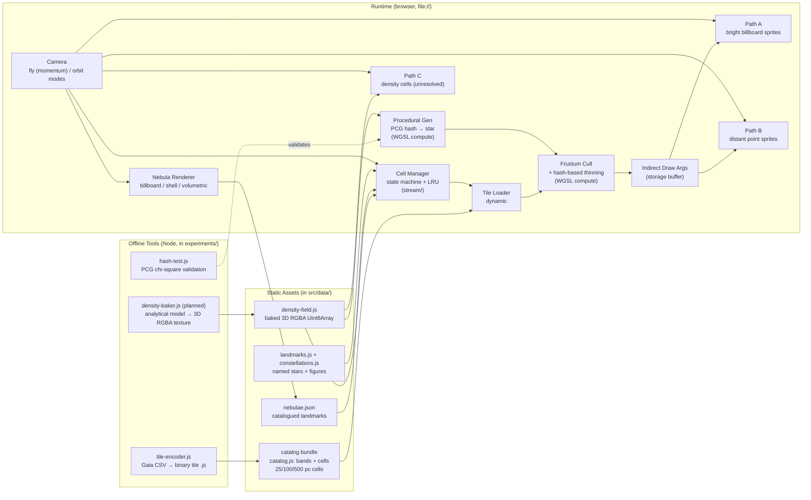

# Galaxy Fly-Through Engine — Development Plan

## 1. Overview

A WebGPU-based galaxy fly-through engine that renders the Milky Way at interactive frame rates, supports up to one million catalog stars and tens of millions of procedurally generated stars, and preserves a physically realistic density distribution at any visible object count.

The engine runs from `file://` with classic `<script>` tags — no build step, no module system, no internet dependency at runtime. All libraries are vendored locally. The same source files can be `require()`'d in Node for testing.

Two operating modes share the same render pipeline:

- **Hybrid mode** — Filtered real catalog stars (Gaia DR3 + Hipparcos + NGC) plus deterministic procedural fill in gaps and far regions.
- **Game mode** — Pure procedural, no catalog. The entire galaxy is generated from a seed and a density model.

In both modes the *density field* is the source of truth. Adjusting the visible object count from 10k to 1M does not change the apparent density — it changes only the sampling rate.

The core problem with raw star catalogs is that they are *not* a uniform sample of the Milky Way. Gaia DR3 contains ~1.46 billion sources, but completeness is essentially complete only between G=12 and G=17, and "at a distance of about 100 pc, the coolest stars become too faint for Gaia's survey limit" ([ESA Cosmos](https://www.cosmos.esa.int)). Useful sampling reaches ~3 kpc for bright tracers ([Vieira et al. 2023](https://www.research.unipd.it)). A naive catalog download therefore produces an over-dense blob centred on the Sun, with empty galaxy everywhere else. This plan solves that by treating the catalog as decoration (named/remarkable stars) and a baked analytical density field as the truth.

Elite Dangerous's "Stellar Forge" is the direct precedent: ~160,000 real Hipparcos stars seed a 1:1 scale Milky Way containing ~400 billion procedurally generated systems ([polygon.com](https://www.polygon.com), [ctrl500.com](https://ctrl500.com), [perthobservatory.com.au](https://perthobservatory.com.au)). The same hybrid pattern — real stars for landmarks, procedural fill for the rest, density model for the shape — is used here.

---

## 2. Architecture



Three stages:

1. **Offline tools** (Node scripts in `experiments/`) convert raw catalogs to binary tile files and bake the density field. They also validate the hash function. These run once per data refresh.
2. **Static assets** are vendored as local files. The catalog ships as **one** bundle file, `src/data/tiles/catalog.js`, which assigns a single object to `window.__galaxy_catalog` (cells as base64 `StarPacked` payloads). One injection per catalog instead of one per cell: 2045 cells would otherwise be 2045 script tags. It loads via classic `<script>` injection under `file://` without fetch.
3. **Runtime** is the browser page. A compute pass per frame generates procedural stars, culls, and produces an indirect draw buffer. The render pass draws three paths (bright, distant, density) plus nebulae.

---

## 3. Coordinate System & Precision

Right-handed Galactic Cartesian coordinates, Sun at origin:

```
X: toward Galactic longitude 0° (galactic centre direction)
Y: toward Galactic longitude 90°
Z: toward the Galactic north pole
unit: parsec
```

CPU simulation uses `f64`. The GPU receives **camera-relative** `f32` coordinates, not absolute Galactic coordinates: the shader subtracts a `f32` `camera.position` uniform from each star. Measured in `experiments/precision-test.js`, that is good to 0.005 pc at 100 kpc — far below one screen pixel — so split-double was dropped rather than carried as dead code (`src/math/split-double.js` is gone). At kpc distances, raw `f32` precision collapses (about 7 decimal digits, so at 10 kpc the precision is ~1 m — fine — but at 100 kpc it's ~10 m, and fly-through jitter becomes visible).

```text
starRelative = starPosition - cameraPosition
starRelativeHigh = floor(starRelative / scale) * scale
starRelativeLow  = starRelative - starRelativeHigh
```

The vertex shader reconstructs the precise position from high+low. The camera moves through the galaxy; the GPU always renders near-zero coordinates. This pattern is standard for planetary-scale rendering and avoids needing `f64` on the GPU (which WebGPU does not support in vertex shaders anyway).

Distance and magnitude conversions use the standard relations:

```
distance_pc = 1000 / parallax_mas
absolute_mag = apparent_mag - 5 * log10(distance_pc) + 5
```

---

## 4. Milky Way Density Model

The accepted model for stellar mass distribution combines four components. The full model is evaluated analytically in `experiments/density-baker.js` (planned for Path C; until then `src/math/density.js` is evaluated directly and `experiments/visualize-data.js` renders it) and later baked into a 3D RGBA texture sampled at runtime.

### Thin disc

```
ρ_thin(R, z) = A_thin · exp(-R / L_thin) · sech²(z / (2 · H_thin))
```

with `L_thin = 2.6 kpc`, `H_thin = 300 pc` ([NED/IPAC](https://ned.ipac.caltech.edu), [Imig 2025](https://iopscience.iop.org)). `sech²` is used instead of a pure exponential for the vertical profile because it matches observation better near the midplane.

### Thick disc

```
ρ_thick(R, z) = A_thick · exp(-R / L_thick) · exp(-|z| / H_thick)
```

with `L_thick = 3.5 kpc`, `H_thick = 900 pc`, and `A_thick / A_thin ≈ 0.12` ([Sysoliatina 2022](https://www.aanda.org)).

### Bulge / bar

Triaxial softened ellipsoid, following the Plummer-like form:

```
ρ_bulge(r_e) = A_bulge · (1 + (r_e / r_0)²)^(-5/2)
r_e = √(x² / a² + y² / b² + z² / c²)
```

with `a = 1.5 kpc, b = 0.5 kpc, c = 0.4 kpc`, oriented 25° from the Sun–centre line ([Portail 2016](https://academic.oup.com)).

That *was* the Milky Way preset's authored bulge. Since 0.4.8 M2 the preset's central
component is the boxy/peanut bar itself, at the observed parameters: half-length
`a = 2.3 kpc`, tilt 27°, the Wegg & Gerhard axis scale lengths carried by the slice
family's knobs (longitudinal cap `endCap·a = 0.70 kpc`; transverse/vertical half-density
extents `ln2·0.44` / `ln2·0.18` kpc via `b = 0.405`, `c = 0.189`), and the amplitude
`31.36` that preserves the Plummer bulge's mass at those axis ratios
(`experiments/preset-bar-fit.js`). The table's barred types (`SB*`) share the profile —
a boxy, peanut-stretched volume with a flat inner part and exponential end caps,
sampled by inverse CDF along the bar's major axis — specified in
`archive/0.3.0-plan-galaxy-types-star-distribution.md` §0.3.1 and made a realistic 3-D shape in
`archive/0.4.8-plan-realistic-3d-shapes.md` §3 (slice profile `barSliceProfile` in `density.js`
with its WGSL mirror, the vertical boxiness knob `bar.vertical`, and the closed-form
slice mass). The Plummer form above remains the smooth-bulge profile for any model that
authors it.

### Stellar halo

Power law:

```
ρ_halo(r) = A_halo · (r / a_h)^(-3.5)    for r > a_h
```

with `a_h = 1 kpc` and `A_halo / A_thin ≈ 0.001` — low density but extends to 100+ kpc.

### Spiral arm modulation

A multiplicative perturbation on the disc components, *not* added as new density:

```
ρ_arms(R, φ) = 1 + A · cos(m · φ − K · ln(R / R_s) + φ₀)      K = m / tan(i)
```

with `m = 2` (two-armed pattern), `A ≈ 0.2`, `i ≈ 12°` the pitch angle, `R_s = 3 kpc`
reference radius ([Khrapov 2021](https://www.mdpi.com)). Used as a probability multiplier
on the disc density, not as a separate component. This keeps the model stable and
controllable. The wavenumber is `m / tan(i)`, not `tan(i)`: a log spiral of pitch `i` is
`φ = ln(R/R_s)/tan(i)`, so multiplying the phase by `m` puts `m/tan(i)` in front of the
logarithm. `K = tan(i)` (what the 0.1-era note wrote) moves a ridge by 0.2 rad over a whole
e-fold in radius instead of 5 rad — the arms come out as a fan of near-radial spokes and
`i` stops being an angle the field has. `density.armWavenumber(model)` is the one place
`K` is computed; `sampling.js`, the WGSL mirror and every test read it.

The ridge lines are then spaced `λ(R) = 2π·R·sin(i)/m = 2π·R / √(m² + K²)` apart
*perpendicular to themselves*, and the distances everything else is written in —
`density.distanceToNearestArm` — are perpendicular distances to the nearest ridge.

The *young* population does not fill that broad enhancement: O/B stars are born in the
compressed lane on the ridge, which is narrower. Its cross-arm width is the pattern's own —
`λ(R)` times a fixed ridge fraction, narrowed by the arm contrast A — and it is the same
width the loose nebulae admit gas on, so stars and clouds trace one lane. Everything that
reads a distance to the ridge (`star-types.js`'s arm-young branch, `nebula.js`) reads this
one function, `density.armRidgeWidth(model, R)`; the numbers and the tests that pin them
live in `archive/0.3.0-plan-galaxy-types-star-distribution.md` §0.3.1.

### Combined

```
ρ_total = (ρ_thin + ρ_thick) · ρ_arms + ρ_bulge + ρ_halo
```

### Truncation

The profiles above are unbounded, which is fine for a picture and useless for a sampler: the Plummer bulge keeps a visible tail out to any radius and the exponential disc never reaches zero. The field is therefore truncated once, in the model itself, and every consumer sees the same cut:

```
disc:   R <= 25 kpc, |z| <= 3 kpc
bulge:  s = r_e / r0 <= 6        (Plummer radii, r0 = 1 kpc)
halo:   r <= 100 kpc             (part of the distribution, not a cut)
```

`density.js` applies these cuts inside `rhoThin` / `rhoThick` / `rhoBulge`, `sampling.js` draws each component inside the same bounds, and the WGSL mirror carries the same constants. Without this the sampler and the renderer disagree about the far field — the sampler truncates, the field does not — and every derived quantity that weights by density (nebula placement, `dominantComponent`, thinning) inherits the mismatch. Truncation also makes each component's contribution a finite number: `sampling.js` reports the truncated delivery fractions so the component shares in the tests have a closed form.

### RGBA texture packing

Baked into a 64×64×32 RGBA8 texture (about 128 KB):

```
R: total stellar density (normalised)
G: young-star density (for blue star placement)
B: dust density (for nebula placement)
A: nebula probability multiplier
```

The analytical form is also evaluated directly in WGSL when needed for cells beyond the texture bounds, so the model is exact everywhere the camera can reach.

---

## 5. Catalog Pipeline

### Source catalogs

| Source | Role | Approx. count after filter | Notes |
|---|---|---|---|
| Hipparcos / Tycho-2 | Named/remarkable stars | ~100k | All-sky, well-measured, includes bright stars Gaia saturates on |
| Gaia DR3 (filtered subset) | Real nearby stars with proper motion | ~200k–1M | Cut to `G < 12` and `parallax_over_error > 5` |
| NGC / Sharpless / Messier | Named clusters & nebulae | ~1k | Catalog of remarkable objects for landmarks |
| TRILEGAL mock catalogue | Calibration only | not shipped | Would validate the density model against a mock catalogue; not used yet |

### Offline tool: `experiments/tile-encoder.js`

Reads Gaia CSV (or FITS via a vendored parser), applies the magnitude and quality cuts, converts RA/dec/parallax to galactic XYZ, and writes one bundle:

```js
// src/data/tiles/catalog.js — one script tag for the whole catalog
window.__galaxy_catalog = {
        version: 1, encoding: 'base64', recordBytes: 16,
        bands: { near: { cellSize: 0.025, streamRadiusKpc: 0.5 }, /* medium, far */ },
        cells: [{ b: 0, c: [i, j, k], n: 42, d: 'base64 StarPacked payload' }],
};
if (typeof module !== 'undefined') module.exports = window.__galaxy_catalog;
```

The dual assignment lets the same file load via `<script>` in the browser and via `require()` in Node tests. Base64 costs ~33% over raw bytes and is invisible next to the HTTP/gzip reality; the alternative (raw `Uint8Array` literals) triples file size and parse time.

### Tile layout

Three LOD bands, fixed cubic cells per band:

```
near region (R < 200 pc):    25 pc cells,  resident within 0.5 kpc of the camera
medium region (R < 2 kpc):  100 pc cells,  resident within 2.5 kpc
far region (R > 2 kpc):     500 pc cells,  resident within 12 kpc
```

The three radii are properties of the data, not of the loader: the encoder writes them into the bundle's band table and `cell-manager.js` reads them from there. Later, replace with a sparse octree; fixed cells are used because the code is simpler and the lookup is `O(1)`.

### Packed star record

Each star in a tile is a 16-byte record:

```
struct StarPacked {        // 16 bytes
        float positionHighX, positionHighY, positionHighZ;  // 12 bytes
        uint32_t packed;                                    // 4 bytes
}
```

Where `packed` encodes:
- bits 0–7: colour index (256-entry lookup texture)
- bits 8–15: apparent magnitude (0–255 mapping to 0–20 mag)
- bits 16–23: flags (binary, variable, nebula-associated, landmark)
- bits 24–31: low-precision position offset (sub-cell jitter)

The low-precision position component plus the position-high gives enough precision for visual purposes. Absolute magnitude, temperature, and proper motion are reconstructed from the colour index via lookup textures — they do not need to be stored per star.

This packs 1 million stars into 16 MB. Five million into 80 MB. Twenty million into 320 MB — but most of those will be procedural and never stored on disk at all (see §7).

### Tile metadata

A cell needs no stored bounds: band cell size plus integer cell index is the box, which is why the payload is pure records. Per-cell metadata is limited to what the residency policy actually consumes:

```
{ b: band, c: [i, j, k], n: starCount, d: base64(payload) }
```

Magnitude statistics per cell are deliberately absent — the renderer derives brightness per star on the GPU from the packed record, and residency is decided by distance, not by magnitude.

---

## 6. Filtering & Priority

The bias problem is solved by *not* removing stars wholesale. Instead, every catalog star receives a priority score and the renderer thins by priority using a stable hash, so popping is impossible.

### Per-star priority score

```
priority =
    2.0 * brightnessScore       // apparent magnitude, brighter = higher
  + 1.0 * qualityScore         // parallax_over_error, well-measured = higher
  + 0.4 * landmarkScore        // named / in NGC / has planets
  + 0.2 * randomScore          // hash(starId) → [0,1], prevents banding
```

Landmarks (very bright, named, in NGC, has planets, in constellation lines) get a strong multiplier so they are never thinned away.

### Stable hash thinning

For each candidate star, compute a per-frame visibility probability:

```
p = clamp(D_target / D_local, 0, 1)
```

Where `D_local` is the local visible-star density (estimated from the cell and visible neighbours) and `D_target` is the configured target density (a runtime budget knob). The star is kept if:

```
hash(starId, tileId, lodLevel) < p
```

Because the hash is deterministic, the same star is always kept or always removed at the same LOD level. No flickering between frames.

### Screen-space thinning (GPU pass)

For each visible tile, a compute shader projects candidate stars to screen space, divides the screen into 2–4 pixel cells, and keeps the highest-priority star per cell. Lower-priority stars in the same cell are dropped. Additional stars in a cell are allowed if their brightness differs substantially from the kept star.

This is essentially the algorithm used by Stellarium and similar planetarium software for crowded-field rendering, and it is cheap to run on a compute shader.

---

## 7. Procedural Generation

Procedural stars fill the gaps left by the catalog and populate regions beyond catalog completeness. The same pipeline powers **game mode** (no catalog at all) — the catalog is simply another procedural source feeding the same compute shader.

### Stable hash

Every procedural star is identified by a 64-bit key:

```
key = hash64(galaxySeed, cellX, cellY, cellZ, slot, populationLayer)
```

The hash is **PCG hash** (Permuted Congruential Generator), recommended by Nathan Reed for GPU rendering ([reedbeta.com](https://www.reedbeta.com)). A fallback Wang hash is available for older GPUs. Both are stateless and parallel-friendly — perfect for WebGPU compute shaders with thousands of threads.

This means star `(seed=42, cell=(15,-3,2), slot=7)` is *always* the same star — same position, same colour, same magnitude, same proper motion. Move the camera, restart the page, switch machines: it does not matter. The galaxy is fully reproducible.

### Cell generation

For each spatial cell around the camera, the compute shader:

1. Evaluates the galaxy density at the cell centre (texture lookup or analytical).
2. Computes expected star count `λ = ρ(cell) · V_cell · luminosity_bias`.
3. Samples the actual count: `count = floor(λ) + (hash01(seed) < fract(λ))`.
4. For each slot `0..count-1`, hashes `(seed, cellId, slot)` and generates the star.
5. Each star has one owning cell — boundaries are handled by assigning the slot a strict-inequality cell test, so no star is ever generated twice.

### Star properties (per slot)

Each slot hash produces:

- Sub-cell position (stratified jitter, no grid alignment).
- Apparent magnitude — sampled from a Salpeter initial mass function, converted to absolute magnitude, then apparent magnitude from distance.
- Colour (B-V) — sampled from a colour-magnitude diagram appropriate to the local population (disc vs. bulge vs. halo).
- Proper motion — small random vector biased toward local galactic rotation.
- Variability flag — ~5% of stars marked as variable with phase and amplitude from hash.

### Magnitude-band completeness

A critical refinement over a single completeness function: the procedural generator tracks catalog completeness *per magnitude band*, because catalogs are often complete for bright stars but incomplete for faint ones at the same distance.

```
bands: 0–4 mag, 4–8 mag, 8–12 mag, 12–16 mag, 16+ mag
```

For each band, the cell knows `N_real_effective(band)` and `N_expected(band)`. The procedural generator produces only:

```
N_synthetic(band) = max(0, N_expected(band) - N_real_effective(band))
```

This prevents synthetic stars from over-populating regions where the catalog is already complete, and ensures they fill the gaps where it is not. In game mode, `N_real_effective(band) = 0` for all bands.

### Two modes share the pipeline

| Mode | Catalog used | Procedural used | Use case |
|---|---|---|---|
| Hybrid | Yes (filtered Gaia + Hipparcos + NGC) | Yes (gap-fill by magnitude band) | Realistic — see actual Pleiades / Orion at correct positions |
| Game | No catalog | Yes (entire galaxy) | Pure procedural exploration, fast startup, no asset download |

The renderer does not know which mode produced a given star. The compute shader's output buffer is the same shape in both modes.

### Density-preserving count scaling

The user's hard requirement: total object count must be adjustable (e.g. down to 10k) without distorting the density distribution. The strategy:

1. The density field defines relative density everywhere. It is the truth.
2. The target star count `T` is a runtime budget (10k, 100k, 1M).
3. A global scaling factor `s = T / Λ_total` (where `Λ_total` is the integral of the density field) multiplies every cell's expected count.
4. At low budgets, individual cells may produce zero stars; the *spatial distribution* remains correct because the rejection sampler still preserves the relative probability.

Result: at 10k stars the galaxy looks like a sparse but correctly-shaped galaxy. At 1M stars it looks like a dense, correctly-shaped galaxy. The user can trade visual richness for frame rate without corrupting structure.

---

## 8. WebGPU Rendering

Three render paths are used, chosen by LOD. A single frame may use all three simultaneously for different regions.

### Path A: bright and nearby stars (billboard sprites)

For stars closer than ~500 pc and brighter than ~6 apparent magnitude. Camera-facing quads sized by magnitude and distance. Fragment shader does soft radial falloff, glow, and optional diffraction spikes for the brightest stars.

Vertex shader input:
```
struct StarPacked { positionHigh: vec3<f32>, positionLow: vec3<f32>, packed: u32 }
```

Reconstruct camera-relative position from high+low. Project to clip space. Expand to a quad of size `f(magnitude, distance)`.

### Path B: distant individual stars (point sprites)

For stars beyond 500 pc or fainter than 6 mag. Plain point sprites, mostly unlabelled. Very cheap — one vertex per star, no expansion.

### Path C: unresolved density cells

For regions beyond ~5 kpc where individual stars occupy less than a pixel. The compute shader writes density-cell records instead of star records:

```
struct DensityCell {
        position: vec3<f32>,
        density: f32,         // integrated star density × volume
        avgColor: u32,        // weighted average colour
}
```

The renderer draws these as additive screen-space quads tinted by colour and density. This is what makes the galactic bulge and spiral arms glow correctly when far away, without spending GPU time on stars that would render as sub-pixel dots.

### Indirect draw + GPU culling

A single compute pass per frame:

1. Reads candidate stars from the catalog tile buffer and the procedural generation buffer.
2. Transforms to camera-relative coordinates.
3. Tests frustum, magnitude, distance LOD.
4. Applies stable hash thinning (§6).
5. Appends visible indices to a storage buffer.
6. Increments an indirect draw count.

```
@group(0) @binding(0) starStorage
@group(0) @binding(1) cellStorage
@group(0) @binding(2) visibleIndexStorage
@group(0) @binding(3) indirectArgsStorage
@group(0) @binding(4) cameraUniforms
@group(0) @binding(5) densityTexture
@group(0) @binding(6) colorLUT          // lookup texture for colour/mag → RGB
```

The render pass calls `drawIndirect` on the indirect args buffer. The CPU never reads the visible-star list. No readback, no per-frame allocation, no GC pressure.

### Memory layout (packed)

One `StarPacked` is 16 bytes. A draw budget of 1M stars means 16 MB of star data resident on the GPU. The visible index buffer is `u32` per star, so 4 MB max. Indirect args are a handful of `u32` values. Total GPU memory budget is well under 50 MB for stars alone — the rest goes to nebulae and the density texture.

---

## 9. Streaming & Cell State Machine

The galaxy is not generated at startup. Space is divided into deterministic cells, and cells around the camera are streamed in/out based on a memory budget.

### Residency

`src/stream/cell-manager.js` keeps one residency set, recomputed when the camera has moved more than half a fine cell (12.5 pc) or 0.25 s have passed, whichever comes first:

1. collect every cell whose box lies within its band's streaming radius of the camera,
2. order candidates nearest-first by squared distance to the cell box, ties broken by cell index,
3. take cells in that order while the running star count stays inside `budgetStars` (default 250,000).

Cells outside every band radius are dropped, so a camera that leaves the catalog volume empties the set and the renderer stops drawing catalog stars. Decoded payloads live in an LRU cache (4096 cells by default), and the GPU buffer is re-uploaded only when the resident set actually changed.

A residency set plus an LRU cache replaces a per-cell state machine: nothing can run off the main thread under `file://` anyway, and a set is far easier to reason about than six states per cell.

### Streaming radii

```
near:    200 pc region      resident within 0.5 kpc      catalog, full detail
medium:  2 kpc region       resident within 2.5 kpc      catalog
far:     10 kpc region      resident within 12 kpc       catalog
```

The radii are data: the encoder writes them into the bundle's band table and the manager reads them from there, so retuning streaming is an asset change, not a code change. Beyond the far radius the procedural field (Path C) covers the sky; individual catalog stars are not streamed that far.

### Memory budget

The catalog budget is denominated in stars, not bytes, because stars are what the visual quality is made of: `budgetStars` (default 250,000) × 16 B = 4 MB of GPU buffer. Byte-denominated budgets return with Path C, where density cells have wildly different costs per visible pixel.

### file://-compatible catalog loading

The catalog is loaded once, via dynamic `<script>` tag injection, not `fetch()`:

```
1. create <script> element with src = data/tiles/catalog.js
2. on script.onload: take window.__galaxy_catalog, delete the global
3. remove <script> element from DOM
4. prepareBundle(): decode the band table, index every cell, build the band radius table
```

This works under `file://` in all major browsers because classic script loading is permitted, while `fetch()` is blocked by CORS for local files in Chrome and Edge. A single script for the whole catalog keeps the DOM mutation to one element; per-cell scripts would be 2045 tags and 2045 parse events for a catalog this size.

---

## 10. Nebulae

Nebulae are independent of the star population. They render in their own pass and may be billboards, shells, or volumetric.

### Star clusters are not nebulae (and not other galaxies)

A globular cluster is a bound group of stars **inside the current galaxy** — an old,
spheroid/halo-leaning example of the general star-cluster population, not a gas
cloud and not an extragalactic object. The code keeps the two layers apart by name
and by file, so the distinction cannot blur again:

- `math/nebula.js` + the gas objects in `math/objects.js` (HII regions, planetary
  nebulae, supernova remnants) are the *nebula* layer. Gas gets a billboard.
- `math/clusters.js` is the *star-cluster* layer. A cluster is stars only: no
  billboard, no `NEBULA_COLORS`, no gas opacity. Its centre is placed inside this
  galaxy's own density field, and no other galaxy is modelled at this stage.

Clusters are **one generalized family, not predefined classes** (no separate
open/globular types, profiles, age boxes or richness boxes). One formula reads the
environment at the centre and turns it into continuous parameters:

- centre and population component: candidates accepted with weight
  `(ρ_spheroid + S_halo·ρ_halo + ½ρ_thick + gasWeight·ρ_thin) / ρ_total` and
  assigned between the spherical halo (`sampling.sampleHaloRadius` +
  `sampling.sampleDirection`) and the in-situ disk/bulge components via
  `clusterComponentWeights(model)`. At the Milky Way reference (`SBb` at
  `13.5 Gyr`) the split is **75% halo to 25% disk/bulge** (Zinn 1985; Harris
  1996/2010; Peng et al. 2006; Kruijssen 2015), averaging ~70–75% halo across
  the spiral/lenticular sequence and rising monotonically with galaxy age as
  gas is consumed and young disc clusters dissolve by GMC/bar tidal shocks.
  Each cluster's age is drawn from its component's formation window
  (`galaxy.FORMATION_WINDOW`) — a halo draw is old because the halo formed
  first, a thin-disc draw is younger, with no per-class age range anywhere;
- internal distribution: one truncated Plummer law for every cluster,
  `r = a/√(u^(−2/3) − 1)` scaled into the enclosed fraction at the tidal radius.
  The Plummer scale `a` is log-drawn (0.5–4 pc) and shrinks as the spheroid/halo
  fraction at the centre grows; the concentration `c = log10(r_tidal/a)` is
  continuous (0.7–1.9) and grows with the same fraction. Diffuse young disc
  clusters and compact old spheroid clusters are the two ends of one continuum;
- cluster count: proportional to the galaxy's delivered stellar mass relative
  to the Milky Way preset (`≈160` clusters there), never a fixed mixed-object
  quota.

**Proper motion and orbital directions.** A cluster moves as one rigid object:
- Each cluster centre is snapped to a `1/32 kpc` (`31.25 pc`) sub-grid inside a
  `1.0 kpc` period (`> 2 × r_tidal,max`), and its 5-bit sub-grid residue is
  packed into the low 5 mantissa bits of each member's `f32` birth coordinates
  (`orbit.packClusterCoord`, `< 0.1 pc` perturbation) alongside
  `StarRecord.FLAG_CLUSTER` (`bit 7` of `flags`, `0x00800000u` in `packed`).
  Both CPU (`orbit.js`) and GPU (`shaders.js`) recover the exact bit-identical
  cluster centre `C = clusterCentre(p)` from the 16-byte `StarPacked` record
  alone, evaluate the orbital displacement at `C(T)`, and add back the member's
  rigid offset `δ = p - C`, so differential rotation never shears a cluster
  into a curved arc of stars.
- Disk and bulge clusters (`thin`, `thick`, `bulge` in disk galaxies) follow
  broadly prograde orbits aligned with the Galactic disk (`FAMILY_PATTERN`,
  `FAMILY_DISC`, `FAMILY_BAR`). Halo clusters (`component = 3`, `FAMILY_PRESSURE`)
  distribute their orbital tangent directions uniformly over `0..2π` in
  `orbitInclination`, producing broad 3-D orbital directions (prograde, polar,
  and retrograde) with no single dominant rotation axis.

**Density budget and the exaggeration coefficient.** Cluster stars are drawn
*on top of* the field, so their count must follow the selected star budget, not
a fixed block. At true scale the whole cluster system is
`CLUSTER_TRUE_FRACTION = 0.001` of the galaxy's stars — in a 100 000-star
render that is ~100 stars spread over ~160 clusters, i.e. invisible. The layer
therefore renders

```
clusterParticles = fieldStars × 0.001 × clusterExaggeration     (default ×50)
```

which is ~5 000 particles at 100k field stars, on the order of 10–100 per
cluster. This is a **visual exaggeration, not a true scale ratio**: `×1` is the
honest scale, `×0` is off, and the coefficient is a view control (menu slider,
`clusters=` preset/URL key) exactly like the pattern-speed multiplier. The gas
objects' member allowance scales with the same field budget
(`objects.gasMemberBudget`), so raising or lowering **Stars** can never leave a
fixed 20k-star object block sitting on a 30k-star galaxy.

### Three tiers

| Tier | Technique | Use case | Cost |
|---|---|---|---|
| Billboard | Camera-facing quad with pre-rendered texture | Most catalogued nebulae (Orion, Lagoon, Eagle) | Cheap |
| Shell | Ellipsoid or irregular shell with 3D noise | Mid-distance nebulae, dust clouds | Medium |
| Volumetric | Raymarch through 3D density texture | Hero nebulae the camera enters | Expensive |

### Catalogued nebulae (hybrid mode)

A short list of named nebulae is shipped as `nebulae.json`:

```
center: vec3 (galactic XYZ)
orientation: quat
size: float (bounding radius)
shape: enum (billboard | shell | volumetric)
color: vec3 (peak emission)
density: float
opacity: float
texture: string (filename) or seed (for procedural)
```

Always rendered when in view.

### Procedural nebulae (both modes)

The density field's `B` channel (dust density) and `A` channel (nebula probability) drive procedural placement. The compute shader samples these channels in spiral arm regions and emits `DensityCell` records with `nebula_probability > threshold` — these become procedural nebula instances.

Each procedural nebula is hash-seeded:

- Centre position (in arm, offset from midplane)
- Three-octave 3D noise field for internal density variation
- Colour tint based on local stellar population (red in HII regions, blue in reflection)

### Volumetric raymarch

For hero nebulae (the few the camera can enter), the renderer raymarches through the nebula's bounding volume:

1. Marches from near to far plane in 32–64 steps.
2. At each step, samples a 3D noise texture (animated FBM) for density.
3. Accumulates emission (coloured by nebula tint × local density) with beer-lambert absorption.
4. Composites over the star background.

Following [Maxime Heckel's volumetric cloudscapes](https://blog.maximeheckel.com) and NVIDIA GPU Gems 3 Ch. 30. The pass is capped: render at half resolution and upscale; skip entirely when the camera is moving fast.

---

## 11. File Structure

Project layout, following AGENTS.md conventions (file:// friendly, no build, vendored libs):

```
galaxy-flythrough/
├── AGENTS.md                           # style + runtime rules
├── plan.md                             # this file
├── findings-pitfalls-skills.md         # LLM notes/pitfalls
├── worklog.md                          # what each task actually did
├── archive/                            # superseded plans
├── experiments/                        # Node scripts, not loaded by the page
│   ├── logs/                           # validation results (one JSON per test)
│   ├── tile-encoder.js                 # Gaia CSV or mock → src/data/tiles/catalog.js
│   ├── tile-stream-test.js             # encoder → loader → cell manager end to end
│   ├── tile-encoder-smoke-test.js      # encoder → bundle → loader round trip
│   ├── renderer-test.js                # star-sprites against a stub WebGPU device
│   ├── wgsl-validate.js                # WGSL mirror vs the JS model
│   ├── m1-smoke-test.js                # module wiring + index.html script order
│   ├── export-parity-test.js           # window.* API == module.exports API
│   ├── camera-test.js                  # camera model, dt independence, no allocations
│   ├── sampling-test.js                # sampler vs the analytical model
│   ├── density-distribution-test.js    # box sampler vs the model
│   ├── star-types-evolution-test.js    # population types vs the evolution model
│   ├── nebula-placement-test.js        # nebula types vs their environments
│   ├── visualize-data.js               # sample for scripts/viz-galaxy.py
│   ├── hash-quality-test.js            # PCG/Wang statistics
│   ├── precision-test.js               # f32 vs split-double at galactic distances
│   ├── packing-test.js                 # StarPacked round trip, memory budget
│   ├── filter-test.js                  # priority score / thinning behaviour
│   └── landmark-test.js                # landmark data, constellations, picking
└── src/                                # runtime, loaded by index.html
    ├── index.html                      # classic <script> tags only
    ├── style.css
    ├── core/
    │   ├── device.js                   # WebGPU device + clamp to adapter limits
    │   ├── camera.js                   # fly (momentum) + orbit modes, ly/s speeds
    │   ├── input.js                    # keyboard/mouse, wheel normalised to px
    │   ├── selection.js                # click picking against the landmarks
    │   └── loop.js                     # frame loop, dt clamp, stats
    ├── math/
    │   ├── hash.js                   # PCG/Wang (mirrors WGSL)
    │   ├── density.js                # analytical density field + truncations
    │   ├── galaxy.js                 # GalaxyModel descriptor + type table
    │   ├── sampling.js               # exact single-pass sampler
    │   ├── star-record.js            # StarPacked layout + colour LUT
    │   ├── star-types.js             # IMF, ages, evolution state, class
    │   ├── nebula.js                 # nebula probability + placement
    │   ├── objects.js                # gas objects (HII / planetary / SNR) + member profiles
    │   ├── clusters.js               # star clusters in this galaxy: one generalized family, scaled particle budget
    │   └── coords.js                 # RA/Dec/parallax → galactic XYZ, world → screen
    ├── stream/
    │   ├── tile-loader.js            # bundle injection, decode, manifest
    │   └── cell-manager.js           # residency set, nearest-first, LRU
    ├── render/
    │   ├── shaders.js                # all WGSL as JS strings
    │   ├── star-sprites.js           # star draw path (global + landmarks + objects + local + catalog)
    │   └── label-layer.js            # 2D overlay canvas: labels + constellation lines
    ├── data/
    │   ├── gaia-subset.csv           # source catalog (5,000 rows)
    │   ├── landmarks.js              # named stars, galactic XYZ baked at load
    │   ├── constellations.js         # figures as pairs of landmark names
    │   └── tiles/catalog.js          # generated bundle (window.__galaxy_catalog)
    └── main.js                       # boot, wires everything
```

Milestones 2+ add the remaining render paths (`density-cell.js`, nebula passes), the baked density field, and the compute pipeline (`cull.wgsl`, `procedural-gen.wgsl`); `shaders.js` already carries those shader sources so they are validated long before they are wired.
### Runtime conventions (see AGENTS.md for full rules)

- **Single tab indentation, LF line endings.**
- **Classic `<script>` tags only** — no ES modules, no bundler, no `import`/`export`.
- **Each file guards `module.exports`** so the same source can be `require()`'d in Node tests.
- **No allocations in the hot path** — frame loop reuses preallocated typed arrays and scratch objects.
- **No internet links** — all libraries vendored in `src/vendor/`.
- **One API object per file, exposed to both environments.** `module.exports` and `window.X` must be the *same* object; never two hand-maintained lists. They drifted apart once and shipped a boot-time `TypeError` (`StarRecord.writeRecord` existed only under Node). `m1-smoke-test.js` and `export-parity-test.js` enforce this.
- **WGSL lives in `src/render/shaders.js` as JS template strings**, not as `.wgsl` files and not as `text/x-wgsl` blocks in `index.html`. Three reasons: the same source can be `require()`'d and diffed in Node by `wgsl-validate.js`; the duplicated copy in `index.html` had already drifted from the `.wgsl` files it was supposed to mirror; and strings need no `getElementById` step at boot. No `fetch()`, so `file://` still works.

### Boot sequence (`main.js`)

```
1. parse URL params (stars, catalog, exposure, seed)
2. init WebGPU device, configure the canvas context
3. create the star renderer (shader module, pipeline, storage buffer, uniform)
4. generate the procedural field on the CPU into the staging buffer (once)
5. inject data/tiles/catalog.js, build the manifest, attach the catalog
6. init the camera at the model home, orbiting the galaxy centre, and the frame loop:
     a. update the camera from input (fly integration or orbit placement, by mode)
     b. cell manager: recompute residency if the camera moved, re-upload if changed
     c. render pass: one instanced draw over [procedural][resident catalog]
     d. present
```

The compute pass (procedural gen on the GPU, cull, indirect args) replaces steps (b)+(c) in the milestone-4 version; the CPU path exists so the flight prototype does not depend on compute support.

---

## 12. Initial Limits

Starting configuration, all runtime-tunable:

```
real catalog stars (resident):       1,000,000
synthetic resident stars:            5,000,000
synthetic generated per frame:        up to 20,000,000+
nearby full-detail radius:           100 pc
catalog streaming radius:            2 kpc
density-cell-only region:            beyond 5 kpc
star sprite size:                    1–6 pixels
GPU culling:                         compute shader
draw submission:                      drawIndirect
target frame rate:                    60 fps (30 fps minimum on integrated)
```

The fundamental scalability rule:

```
millions of packed records in storage
hundreds of thousands or millions actually drawn
billions represented statistically via density cells
```

That separation is what makes the project scalable. A 1 M star hybrid scene and a 100 star scene use the same renderer — only the budgets differ.

---

## 13. Implementation Order

The order matters. Build the renderer and streaming first; procedural generation is added as an additional data source, not a separate engine.

1. **Camera-relative coordinate system.** `split-double.js`, `camera.js`, `coord.js`. Validate precision with `experiments/precision-test.js`.
2. **Packed GPU star buffer.** `StarPacked` struct, colour LUT, staging buffer upload.
3. **Basic point-sprite renderer (Path B).** One vertex per star, simple fragment shader. Hard-coded 100k test stars in a cube.
4. **Spatial tile loading.** `tile-loader.js`, `cell-manager.js`, dynamic `<script>` injection. Load real catalog tiles.
5. **GPU frustum culling.** `cull.wgsl` compute shader, `drawIndirect` render path.
6. **Stable deterministic thinning.** Per-star priority score, hash-based visibility. `experiments/hash-test.js` validates PCG quality.
7. **Real catalog filtering.** `tile-encoder.js` applies magnitude cut, parallax quality cut, magnitude-band completeness tracking.
8. **Synthetic density generation.** `procedural-gen.wgsl` compute shader, density texture lookup, PCG hash → star properties.
9. **LOD density rendering (Path C).** `density-cell.wgsl`, additive screen-space quads.
10. **Nebula rendering.** Billboard tier first, then shell, then volumetric for hero nebulae.

Do not begin with procedural galaxy generation. First make the catalog renderer fast, stable, and visually controllable. Once the renderer and streaming system work, the synthetic population plugs in as another data source feeding the same compute-cull-render pipeline.

---

## 14. Milestones

### Milestone 1 — WebGPU flight prototype
- Free-fly camera, camera-relative coordinates, split-double precision
- 100k hard-coded test stars
- Point sprites (Path B only)
- FPS and GPU timing overlay

### Milestone 2 — One-million-star catalog
- `tile-encoder.js` produces binary tiles from Gaia CSV
- CPU tile streaming via dynamic `<script>` injection
- GPU frustum culling, `drawIndirect`
- 1M real stars, all three LOD bands

### Milestone 3 — Density-aware filtering
- Per-star priority score
- Stable hash thinning
- Screen-space occupancy grid (compute shader)
- Brightness-priority retention
- Smooth LOD transitions, no popping

### Milestone 4 — Procedural filling
- PCG hash in WGSL
- Density texture lookup
- Disc, bulge, thick-disc, halo model
- Magnitude-band gap filling
- Hybrid mode operational

### Milestone 5 — Game mode & large-scale galaxy
- Toggle hybrid ↔ pure-procedural
- Spiral arm modulation
- Path C density-cell rendering
- High/low coordinate precision everywhere
- Count scaling: 10k ↔ 1M with density preserved

### Milestone 6 — Nebulae
- `nebulae.json` format, catalogued landmarks
- Billboard renderer
- Dust absorption
- Shell noise
- Volumetric raymarcher for hero nebulae

### Milestone 7 — Optimisation
- Indirect draws, GPU-generated visible lists
- Worker-based streaming (OffscreenCanvas, optional)
- Compressed binary tiles
- Memory budgets enforced
- Profiling on integrated graphics

---

## 14a. Deferred Tuning Phase

After Milestones 1–7 ship a working renderer, the following tuning tasks refine correctness, performance, and visual quality. They are intentionally deferred because they depend on measurements from a running system and have known trade-offs that should be evaluated empirically rather than guessed.

The first three experiments in this phase have already been implemented as scripts in `experiments/` and have baseline measurements. The remaining items are speculative until the runtime exists.

### Tuning tasks (with implemented experiments)

| # | Task | Experiment script | Log | Status |
|---|---|---|---|---|
| T1 | Validate PCG hash quality (chi-square, serial correlation, spectral, period) | `experiments/hash-quality-test.js` | `logs/hash-quality.json` | Baseline measured. PCG passes all 4 tests. Wang passes 2/4 (used as fallback only). |
| T2 | Quantify f32 vs split-double precision at kpc distances | `experiments/precision-test.js` | `logs/precision-test.json` | Baseline measured. f32 max error at 100 kpc = 0.005 pc (well below star-size threshold). Split-double is unnecessary for star rendering. Use it only for camera-position offset computation if jitter appears. |
| T3 | Validate packed 16-byte StarPacked struct round-trip + memory budget | `experiments/packing-test.js` | `logs/packing-test.json` | Baseline measured. Round-trip fidelity: position max error 7e-7 kpc (f32 round), magnitude quantum 0.078 mag. 1M stars = 19.2 MB total GPU memory. 5M stars = 95.5 MB. 20M stars = 381.6 MB. |
| T4 | Validate per-star priority score + magnitude-band completeness + hash thinning determinism | `experiments/filter-test.js` | `logs/filter-test.json` | Baseline measured. Priority distribution: max bucket 5.2% (no banding). Hash thinning: deterministic, actual fraction 0.298 vs target 0.3 (within 1%). Screen-space thinning preserves highest-priority in 100% of cells. |
| T5 | Arm contrast in the sampled field | `experiments/sampling-test.js`, `experiments/density-distribution-test.js` | `logs/sampling.json`, `logs/density-distribution.json` | Done. The 1.25-vs-1.50 discrepancy was a bad reference (a fixed-kpc box discounts the arm term); the sampler reproduces `1 + A·cos(theta)` to within a few percent on 600k stars, and the R / z / phi histograms match the model. |
| T6 | Nebula type mixture | `experiments/nebula-placement-test.js` | `logs/nebula-placement.json` | Done. HII sits on the arm ridges, planetary nebulae dominate the inner galaxy, no nebula lands in the halo, and the type mix follows the gas/stellar probability split. Mixture weights remain tunable once nebulae render in-scene. |
| T7 | Catalog streaming: residency, hysteresis, nearest-first budget, decode cache | `experiments/tile-stream-test.js` | `logs/tile-stream.json` | Done. Encoder → loader → cell manager consistency, hysteresis at 12.5 pc, an empty sample outside the volume, and the tight-budget selection matching a brute-force nearest-first fill. |
| T8 | Renderer behaviour without a GPU | `experiments/renderer-test.js` | `logs/renderer.json` | Done. `star-sprites.js` runs against a stub device: buffer sizing, procedural upload once, catalog upload only on residency change, instance count, uniform packing and exposure clamping. |
| T9 | Browser/Node API drift | `experiments/export-parity-test.js` | `logs/export-parity.json` | Done, and it caught a real bug (`StarRecord.writeRecord` was missing from the browser export). Every module now exposes one object to both environments. |

### Speculative tuning (deferred until runtime exists)

- **Camera-position precision**: measured `precision-test.js` says f32 with camera-relative subtraction is good to 0.005 pc at 100 kpc; revisit only if jitter is ever seen beyond that.
- **Cell size optimisation**: currently 25 / 100 / 500 pc with 0.5 / 2.5 / 12 kpc streaming radii. Measure decode hit rate and re-upload cost at other splits once a browser profile exists.
- **Workgroup size**: `procedural-gen.wgsl` uses 8×8×1 (64 threads). Profile 8×8×1 vs 16×16×1 vs 32×1×1 on target GPUs once a runnable benchmark exists.
- **Indirect draw batching**: currently one `drawIndirect` per frame for all stars. Once nebulae and density cells are separate paths, evaluate merging into a single multi-draw-indirect call.
- **Tile compression**: 16-byte records may compress to ~10 bytes with delta encoding relative to cell centre. Defer until memory pressure appears in profiling.
- **Variable star animation**: ~5% of stars are flagged variable in `procedural-gen.wgsl`. Phase and amplitude are hash-derived. Tune amplitude distribution once animated rendering is visible.
- **Proper motion drift**: currently zero. Add small proper-motion vector per star once long-running sessions are tested.
- **LOD transition smoothness**: hash-based thinning prevents popping, but cross-LOD transitions may still show density steps. Add hysteresis once visible.
- **Bulge bar tilt**: currently fixed at 27°. May need to animate over cosmic time once a "time scrubber" UI is added (Milestone 6 stretch).

### Tuning methodology

1. Run the relevant experiment script to capture the baseline.
2. Change the constant in `src/math/*.js` — the source of truth.
3. Change the mirrored constant in `src/render/shaders.js` if the shader uses it.
4. Run `experiments/wgsl-validate.js`; it fails if the mirror no longer matches.
5. Re-run the experiment and confirm the metric improved.
6. Append the before/after to `findings-pitfalls-skills.md` with a dated entry.

The split between the JS model (testable in Node) and the WGSL mirror (what the GPU runs) is unavoidable; the validator is the contract that keeps them in sync, and it diffs constants, function names and structural markers rather than trusting the two files to be edited together.

---

## 15. Risks & Mitigations

| Risk | Likelihood | Impact | Mitigation |
|---|---|---|---|
| WebGPU not available on target browser | Medium | High | Detect at runtime; clear error message with browser support link |
| 1M stars drops below 60 fps on integrated GPUs | Medium | Medium | Budget slider; density field stays correct at any budget |
| Catalog asset too large for web delivery | Medium | Medium | The bundle is 165 KB for the 5,000-star subset; a full 1M-star catalog is ~16 MB raw, and base64 adds a third on top, so wide delivery goes through gzip/HTTP rather than `file://` |
| Procedural star positions show grid alignment | Low | Medium | Stratified jitter within each cell; verify with nearest-neighbour histogram |
| Nebula volumetric pass dominates frame time | Medium | High | Cap ray count; render at half resolution; skip when camera moves fast |
| PCG hash shows visible patterns at scale | Low | High | `experiments/hash-test.js` runs chi-square; switch hash if it fails |
| `file://` blocks dynamic `<script>` injection in some browsers | Low | High | Classic script injection is the one loading mechanism `file://` permits; the catalog is already a single base64 bundle, so there is nothing further to fall back to |
| Catalog download (Gaia DR3) is multi-GB | High | Medium | Run `tile-encoder.js` once; ship only the filtered tiles (~50–200 MB) |
| Density model looks right near Sun but wrong in bulge | Medium | Medium | Compare against a TRILEGAL mock catalogue; `experiments/density-distribution-test.js` already checks the sampler against the model |

---

## 16. Open Questions

- **Time scale for proper motion**: real-time is invisible. Either accelerate by 10^6× or expose a "time scrubber" UI.
- **Asset licensing**: Gaia DR3 is ESA CC-BY; Hipparcos is open; NGC references need verification before shipping.
- **Worker offload**: keep main-thread initially; add OffscreenCanvas worker in Milestone 7 only if profiling demands it. Workers complicate `file://` loading.
- **Save/load bookmarked positions**: defer to a stretch milestone; serialise camera position + seed to URL hash.

---

## 17. References

### Catalogs & completeness bias
- ESA Cosmos — *Gaia EDR3 Catalogue of Nearby Stars* — https://www.cosmos.esa.int
- dc.g-vo.org — *Gaia EDR3 completeness notes* — https://dc.g-vo.org
- Vieira et al. 2023 — *Vertical Structure of the Milky Way Disk with Gaia DR3* — https://www.research.unipd.it
- Bailer-Jones et al. — *Distances for 1.47 billion stars in Gaia DR3* — https://www2.mpia-hd.mpg.de
- Gaia Collaboration 2025 — *Gaia: Ten Years of Surveying the Milky Way* — https://arxiv.org

### Milky Way density model
- NED/IPAC — *Mass distribution in disk galaxies* — https://ned.ipac.caltech.edu
- Li 2016 — *Modelling mass distribution of the Milky Way galaxy* — https://arxiv.org
- Sysoliatina 2022 — *Towards a fully consistent Milky Way disk model* — https://www.aanda.org
- Portail 2016 — *Dynamical modelling of the galactic bulge and bar* — https://academic.oup.com
- Khrapov 2021 — *Modeling of Spiral Structure in a Multi-Component Milky Way* — https://www.mdpi.com
- Imig 2025 — *Density Structure and Integrated Properties of the Milky Way* — https://iopscience.iop.org

### Procedural galaxy generation (industry)
- Frontier Forums — *Are new systems procedurally generated?* — https://forums.frontier.co.uk
- ctrl500 — *Our Entire Galaxy Re-created In Elite: Dangerous* — https://ctrl500.com
- Polygon — *Elite Dangerous: Odyssey* (400B star systems) — https://www.polygon.com
- Perth Observatory — *Elite Dangerous / Stellar Forge* — https://perthobservatory.com.au
- SpaceEngine — *Procedural galaxies* — https://spaceengine.org
- Martin Devans — *Procedural Generation For Dummies: Galaxy Generation* — https://martindevans.me

### Synthetic population models
- Gao 2013 — *Detailed comparison of Milky Way models based on stellar counts* — https://www.aanda.org
- Besançon Galaxy Model — https://perso.astrophy.u-bordeaux.fr
- Pasetto 2018 — *GalMod: the last frontier of Galaxy population synthesis models* — https://ui.adsabs.harvard.edu

### WebGPU & GPU rendering
- Kitware — *Achieving Interactivity with a Point Cloud of 2 Billion* — https://www.kitware.com
- Magnopus — *How we render extremely large point clouds* — https://www.magnopus.com
- Arenbro 2026 — *An Evaluation of WebGPU Point Cloud Rendering* — https://www.diva-portal.org
- TU Wien — *Rendering of Point Clouds via WebGPU* — https://www.cg.tuwien.ac.at
- Three.js Roadmap — *Interactive Galaxy with WebGPU Compute Shaders* — https://threejsroadmap.com
- Inria HAL 2026 — *Massive Procedural Rendering of Stars on the GPU* — https://inria.hal.science

### Hash functions
- Nathan Reed — *Hash Functions for GPU Rendering* — https://www.reedbeta.com
- PCG Wiki — *Hash Function* — https://pcg.wikidot.com
- pcg-random.org — *Developing a seed_seq Alternative* — https://www.pcg-random.org

### Nebula & volumetric rendering
- Maxime Heckel — *Real-time dreamy Cloudscapes with Volumetric rendering* — https://blog.maximeheckel.com
- NVIDIA GPU Gems 3 Ch. 30 — *Real-Time Simulation and Rendering of 3D Fluids* — https://developer.nvidia.com
- Casey Primozic — *Volumetric Rendering Experiment* — https://cprimozic.net

---

## 18. Upcoming: 0.1.1 — 0.1.5

`archive/0.1.1-draft.md` is the original one-line brief and `archive/0.1.1-plan.md`
the first expansion of it; both are superseded by this section, which is the spec
a fork should implement from. `archive/plan-0.1.1-tasks.md` is the per-file checklist.

### 0.1.1 — Camera modes (implemented)

**Brief:** fly / orbit the galactic centre / orbit the selected object, wheel ×2 speed
or distance, 8 ly/s default, Shift ×100, Ctrl ×0.1, `H` home. The cycle key this
section introduced is superseded (ui.4): the modes are entered explicitly —
`f` free fly, `c` orbit the selected object, `Shift+C` orbit the galactic centre.

#### Modes and quaternion orientation

```
MODE_FLY = 0   MODE_ORBIT_GC = 1   MODE_ORBIT_OBJECT = 2
f              Shift+C             c                    (ui.4; was the KeyC cycle)
```

The camera orientation is a **unit quaternion**. Local axes are `+X` forward, `−Y`
screen-right and `+Z` screen-up at the default Sun view; the quaternion rotates those
axes into the galaxy frame and produces the `forward` / `right` / `up` basis. There is no
pitch clamp and no pole singularity: mouse look can go straight up/down and continue
through a full loop. `getState().yaw` and `.pitch` are derived diagnostics for tests and
future save files, not integration state.

Fly mode integrates position with momentum. Orbit mode derives position from the same
quaternion basis:

```
forward  = quat · localForward
position = target − orbitDistance · forward          (orbit modes, every frame)
```

Consequences, and why the first plan's separate `orbitYaw/orbitPitch` was dropped:

- Mouse look is the same code in both modes. In orbit it moves the camera on the
  sphere while the target stays centred, and it lands on the standard "grab the
  world" convention (drag right → camera swings left, the scene turns with the
  cursor; drag down → camera rises) without a sign table.
- Entering orbit snaps the *orientation*, not the position: `orbitDistance = |P − T|`,
  the quaternion is minimally rotated so `forward = normalize(T − P)`, then
  `position = T − d·forward` reproduces P exactly. Looking from directly above the Sun
  to the Sun is therefore exact instead of sliding sideways to avoid a pitch pole.
  Leaving orbit changes nothing — position and quaternion continue, velocity is already
  zero. Switching is continuous both ways.
- The view matrix uses the quaternion `right` and `up` axes directly. It does not rebuild
  them from `forward × worldUp`, because that would reintroduce the old pole singularity
  and discard the camera roll/upside-down state after a loop.
- No momentum in orbit: `velocity` is zeroed on entry and never integrated, so the
  camera cannot drift off the sphere.

Targets. `ORBIT_GC` circles `DensityLib.GALACTIC_CENTRE` (read from the model, not a
second copy of 8.178). `ORBIT_OBJECT` circles `objectTarget`, a `Float64Array(3)` set by
`setOrbitTarget(x, y, z, name)` and defaulting to the Sun, so the mode is usable before
0.1.2 adds selection; a call while `ORBIT_OBJECT` is active re-snaps to the new target
from the current position (the camera turns, it does not teleport). Distance clamps to
`[ORBIT_DISTANCE_MIN = 0.0001 kpc, ORBIT_DISTANCE_MAX = 100 kpc]`; orientation is
unlimited (`PITCH_LIMIT` remains exported as `Infinity` only for compatibility).

#### Controls

| Input | Fly | Orbit (both) |
|---|---|---|
| mouse | pointer-lock look (drag fallback) | canvas press-and-drag on the sphere; cursor visible |
| scroll | speed ×2 per notch (up = faster) | distance ×2 per notch (up = closer) |
| W / S, ↑ / ↓ | forward / back | dolly: ×2^(∓ORBIT_DOLLY_RATE·dt) — halves or doubles per second |
| A / D, ← / → | strafe | circle left / right at ORBIT_TURN_RATE rad/s (D moves the camera right) |
| E / Q | camera-local up / down | rise over / dip under the target at ORBIT_TURN_RATE |
| Shift / Ctrl | ×100 / ×0.1 (both held: ×10) | ×4 / ×0.25 on the key rates (`ORBIT_KEY_BOOST`) — ×100 on an angular rate is 16 turns a second |
| C | next mode | next mode |
| H | teleport to `START_POSITION`, home orientation, velocity 0; speed multiplier kept | `ORBIT_OBJECT` around the Sun at `HOME_ORBIT_DISTANCE = 0.01 kpc`, viewing direction kept |
| R | full reset: home + speedMult 1 + object target back to the Sun | same |

Key semantics differ from mouse semantics on purpose: keys *move the camera* (D goes
right, E goes up, as in fly), the mouse *grabs the world*. Google Earth uses the same
split.

Ctrl is the brief's choice and carries one trap: **Ctrl+W closes the tab on Windows and
Linux and no page can prevent it.** Every mapped key calls `preventDefault()` so Ctrl+R
(reload) and Ctrl+H (history) are safe; for slow flight forward use Ctrl+↑. The help text
says so.

#### Wheel: whole notches, accumulated

`input.js` normalises `deltaMode` to pixels (`WHEEL_UNITS_PER_MODE = [1, 100/3, 100]`:
Chrome mice report 100 px per notch, Firefox 3 lines per notch) and the camera keeps a
persistent accumulator:

```
wheelAccum += input.wheelDelta;  input.wheelDelta = 0
notches     = trunc(wheelAccum / WHEEL_NOTCH_PX)        // WHEEL_NOTCH_PX = 100
wheelAccum -= notches · WHEEL_NOTCH_PX                   // remainder carries over
fly:   speedMult     = clamp(speedMult · 2^−notches, SPEED_MULT_MIN, SPEED_MULT_MAX)
orbit: orbitDistance = clamp(orbitDistance · 2^notches,  ORBIT_DISTANCE_MIN, ORBIT_DISTANCE_MAX)
```

Rounding per frame (`round(wheelDelta/100)`) would make trackpads inert: their 3–10 px
events round to zero and were then discarded. The clamps are `1/64` and `256` — powers
of two — because the multiplier walks a ×2 grid and must be able to return to exactly
×1; clamping at 0.02 would leave it on 0.02·2ⁿ forever.

#### Constants

```
LY_TO_KPC          = 0.000306601        1 ly = 0.306601 pc
BASE_SPEED_KPC_S   = 8 · LY_TO_KPC      = 0.00245281 kpc/s
SPEED_MULT_MIN/MAX = 1/64, 256          0.125 ly/s … 2048 ly/s; ×0.1 … ×100 on top
BOOST_FACTOR       = 100 (Shift)        SLOW_FACTOR = 0.1 (Ctrl)
WHEEL_NOTCH_PX     = 100
ORBIT_DISTANCE_MIN = 0.0001 kpc         ORBIT_DISTANCE_MAX = 100 kpc
ORBIT_TURN_RATE    = 1.0 rad/s          ORBIT_DOLLY_RATE = 1.0 octave/s
ORBIT_KEY_BOOST    = 4                  Shift ×4, Ctrl ×0.25 in orbit
HOME_ORBIT_DISTANCE= 0.01 kpc
PITCH_LIMIT        = Infinity           compatibility export; orientation itself is unlimited
START_POSITION     = (0, 0, 0.005)      SUN_POSITION = (0, 0, 0)
```

`getState(out)` adds `mode`, `modeName` (from the constant `MODE_NAMES` table, no
string building), `orbitTarget`, `orientation` (`[x, y, z, w]` quaternion), diagnostic
`yaw`/`pitch`, `orbitDistance`, `targetName`, `speedFactor` (the Shift/Ctrl product last
seen), `speedKpcPerSec` (includes the factor) and `speedLyPerSec`. The overlay prints
`camera <mode>`, speed in ly/s with the factor, and the orbit target and distance when
orbiting. Per-frame cost is unchanged: no allocation, the same preallocated `viewProj` /
`cameraPos` / basis arrays.

#### Startup and pointer interaction

The page starts with exposure 22, star-time rate 1 Myr/s, and galaxy-centre
orbit mode (from the model home position), then flies to the home colony beside
the Sun and rides it, the trade scenario's opening (trade-plan §8). Explicit URL exposure overrides still
apply. The camera library's fly/reset semantics are unchanged. The settings menu
is open at boot (`#menu` has no inline `display:none`, so it renders in the
default block state the toggle writes back); Tab closes it.

Fly mode requests pointer lock on canvas press, with drag-look as a fallback.
Escape releases the cursor; opening the menu with Tab also releases pointer lock.
Both orbit modes keep the cursor visible; mouse rotation requires a primary-button
drag begun on the canvas (keyboard orbit controls are unchanged). Switching out of fly releases pointer lock; switching
back requires a fresh canvas press to lock again. The page synchronizes input
policy from the camera mode after each camera step (including c, C, f, H and R).

Menu/form controls own their keyboard and mouse events (except Tab to toggle the
menu). Wheel events affect the camera only over the canvas. A selection requires
a canvas press and release without a drag; menu releases and releases outside
the canvas cannot select stars. Blur, focus entering UI, and fly/orbit transitions
clear pending look/drag/held-key state.

#### Input additions

`keys.slow` (`ControlLeft`/`ControlRight` — the DOM codes are `Control*`, not `Ctrl*`),
`actions.home` (`KeyH`). ui.4 replaced the cycle action with a shift-cased pair
(`KeyC` → `orbitObject` / `orbitCentre`, `KeyF` → `flyMode` / `flyTo`) plus
`gameMode` (`KeyG`); the orbit/fly actions are consumed by main.js, which owns the
selection store their target comes from. One-shot actions ignore `e.repeat` so a held
key does not re-fire at the key-repeat rate; exposure keys accumulate
(`+= ±1`) so repeat is one more step and two repeats in one frame are two steps.

#### Tests (`experiments/camera-test.js`)

Units (8 ly/s in kpc), wheel notch ×2 in both directions, accumulation across frames and
remainder carry, clamps land on powers of two, boost ×100 / slow ×0.1 / both ×10, mode
entry via `setMode` and action consumption, orbit entry keeps the position and aims at the target,
position stays on the sphere under random look input, the camera can look straight up
and loop past the old pitch pole, the projection keeps quaternion right/up at the pole,
wheel and W/S change distance, A/D and E/Q turn at the documented rate and are
dt-independent, distance clamps, the default object target is the Sun, `setOrbitTarget`
re-snaps, `H` in fly and in orbit, `R` restores everything, orbit → fly is continuous
with zero velocity, buffers are never reallocated across mode switches.

#### Camera Fly-to flight and follow (implemented; supersedes the teleport in archive/0.5.0 §3.4)

`flyToStar(x, y, z, name, standOffKpc)` animates the move instead of teleporting:
the camera travels from its current pose to the stand-off orbit in a fixed
`FLIGHT_DURATION_S = 2 s` of wall time, then orbit-object mode takes over. The
stand-off law (`0.0006·√(L/L☉)` clamped to `[0.0001, 0.01]` kpc) is unchanged.

* **Pose contract.** The `(x, y, z)` a caller hands `flyToStar` is where the sky
  draws the star, not the record's birth position — main.js resolves it through
  `selection.resolveDrawn` (§19's ui.2); the two are kiloparsecs apart once the
  star clock has run. At launch the camera records position and quaternion and
  stops (`velocity = 0`, speed multiplier untouched). The arrival pose is
  derived live every frame, never stored once: arrival position
  `E = T + approach·d` on the line from the target `T` back along the launch
  bearing `approach = normalize(P0 − T)` (degenerate launch: along `−forward`),
  at distance `d = clamp(standOffKpc)` — or the current target distance when
  `standOffKpc ≤ 0`; arrival orientation looks at `T` with galactic north `+Z`
  as up (a launch bearing within 0.01 of the pole keeps the camera's current
  up instead), orthonormalized against the arrival forward.
* **Path.** `s = clamp(elapsed/2)` eased with smoothstep `s²(3−2s)`; position
  is the f64 lerp `P0 → E`, orientation the shortest-path quaternion slerp
  `Q0 → Q`. Both endpoints re-evaluate while `s < 1`, so a target that moves
  during the flight is met where it arrives, not where the launch aimed. A
  straight line plus slerp is predictable, cannot sweep the camera through the
  disc, and lands exactly.
* **Follow.** New `camera.updateTarget(x, y, z)` moves the object target in
  place — no re-snap, no rename. Orbit mode already re-derives the position
  from the target every frame, so after arrival the star stays centred at the
  stand-off for free; during the flight the live end pose does the same.
  main.js feeds it the star's **drawn** position every frame while the camera is
  in orbit-object mode (see §19's ui.2): one `selection.resolveDrawn` dispatch —
  the law the labels and the picker run — for every block and every engine mask,
  keyed by the set member's identity so a residency rebuild that re-slots it does
  not lose it. The narrower ui.0 feed (landmarks only, `simple` only, through
  `OrbitLib.simpleLandmarkPosition`) is superseded; what remains of the honest
  gap is the mask's own report — under a `simple` bit a field star's θ lives in
  the GPU buffer, so the dispatch approximates and the readout says so. (The
  trade network's own dispatch carries a *tracked* mirror of the same law for its
  ≤ 512 endpoints, trade-plan §9.5; that is a per-network selection, not a
  general-purpose CPU copy of the field.)
* **Handover and cancel.** At `s = 1` the flight ends with
  `orbitDistance = d` and `placeOnOrbit()` — the pose the path already
  reached, so arrival is continuous. Any user input cancels: a look delta, a
  movement key, a wheel notch, or C/H/R ends the flight at the current pose
  (`orbitDistance = |T − P|`, the same re-snap a mode switch uses) and hands
  control over the same frame. A second `flyToStar` mid-flight relaunches from
  the current pose. Galaxy-frame changes (`setFrame`, `goHome`, `reset`,
  `setState`, `setOrbitTarget`) end the flight without flying on.
* **Readout.** `getState()` exposes `flying` and `flightProgress`; the overlay
  camera line reads `camera flying to <name> NN%` while the flight runs.
* Allocation-free: the flight reuses preallocated f64 scratch (start pose,
  approach, up, arrival quaternion); frame-rate independence comes from
  easing on `elapsed/duration`, not on dt.

### 0.1.2 — Landmarks & constellations (implemented)

**Goal:** 30–60 named stars with on-screen labels, `P` toggles constellation
lines, click selects the orbit target.

- Data: `src/data/landmarks.js` — one API object, entries `{ name, ra, dec,
  distPc, mag, colorIndex, constellation }` plus galactic XYZ and the absolute
  magnitude (`M = m − 5·log10(d_pc) + 5`) computed once at load through the
  RA/Dec/parallax → XYZ conversion in `src/math/coords.js`. That conversion
  moved there from the encoder so both datasets share one frame; Sirius and the
  galactic centre remain its self-tests in `tile-encoder.js`.
  `src/data/constellations.js` — 15 figures as pairs of landmark names,
  resolved to landmark indices at load; an unknown name throws at load.
- Rendering the stars themselves: Gaia saturates on the brightest stars, so the
  landmarks are **not** assumed to be in the catalog subset. They are written
  as a fixed extra block between the procedural block and the catalog region —
  `[procedural][landmarks][catalog]` — with `FLAG_VISIBLE | FLAG_LANDMARK`
  (already reserved in `StarRecord`), so the drawn instance range stays
  contiguous and they render as sprites regardless of the catalog.
- Labels and lines: a 2D canvas over the WebGPU canvas (`#labels`, pointer
  events pass through), drawn in CSS pixels under a devicePixelRatio transform.
  Drawn **every frame**, not at the 4 Hz overlay cadence — a label that updates
  at 4 Hz visibly trails its star while the camera moves. ~60 projections and
  ~60 `fillText` calls with constant strings allocate nothing. Cull labels
  behind the camera (`clip.w <= 0`) and skip a line when either end is behind;
  lines are screen-space segments, adequate at these separations. Lines default
  to on; `P` toggles.
- Selection: `src/core/selection.js` — `pick(screenX, screenY)` projects the
  landmarks with the camera's `viewProj` and returns the nearest within
  `PICK_RADIUS_PX = 20`; a click without drag (mouse-up within 4 px of
  mouse-down) picks. Under pointer lock the client coordinates are frozen, so
  the pick point is the canvas centre — where the camera aims. The result calls
  `camera.setOrbitTarget(x, y, z, name)` and, in fly mode, the overlay shows
  the name. `R` clears the selection along with the orbit target.
- Input: `actions.pick` with the click position (`pickX` / `pickY`, canvas
  relative), `actions.constellations` (`KeyP`, one-shot).
- Tests: `landmark-test.js` — XYZ conversion against known stars, every
  constellation edge resolves, picking returns the projected-nearest landmark
  (real data + synthetic scene), no entry is duplicated, and the label layer
  draws labels, culls behind the camera and honours the line toggle.

### 0.1.5 — HDR output with range adjustment (next)

**Goal:** the frame accumulates linear flux and is tone-mapped once, with an exposure
range the user controls. Multiple stars at the same screen position must sum their
flux linearly and only roll off at the tone-map stage, so the bulge and arm ridges
keep their color and brightness gradient instead of clipping to white.

- Why a second pass: today each sprite applies Reinhard `flux/(1+flux)` in the vertex
  shader and the additive blend sums the *tone-mapped* values, so dense regions
  (bulge, arms) clip to white with no highlight structure. Correct order is
  accumulate linear, tone-map last. Per-star brightness is now the raw linear flux
  `pow(10, -0.4·(m_app − magZero))` with no per-star roll-off; the alpha channel
  carries the same flux for premultiplied additive blend.
- Renderer: two paths, picked once at boot by the device layer.
  - SDR path (no HDR canvas): stars → `rgba16float` intermediate (recreated on
    resize, blendable per WebGPU core spec on every adapter) → fullscreen
    tone-map pass into the swapchain. `WIRED_SHADERS` carries three shaders:
    `star-sprite`, `star-sprite-hdr`, `tonemap`. The SDR path compiles all
    three (the HDR-direct pipeline is created but not used) and runs two
    passes per frame.
  - HDR direct path (canvas is `rgba16float` + `toneMapping:{mode:'extended'}`):
    sprites write linear flux × `uExposure` straight to the swapchain. No
    intermediate texture, no tonemap pass — the HDR-capable display does the
    highlight rolloff itself. One pass per frame. `;` / `'` still adjusts
    `uExposure`, now multiplied in the sprite fragment shader (binding 3).
  - `device.js` tries `rgba16float` + `toneMapping:'extended'` + `colorSpace:
    'srgb'` + `alphaMode:'opaque'`; if `configure()` throws (non-HDR display,
    older browser), it falls back to the SDR preferred format with
    `alphaMode:'premultiplied'`. The returned `hdr` flag tells the renderer
    which path to take.
- Curve: ACES fitted (Narkowicz) `x·(2.51x+0.03)/(x·(2.43x+0.59)+0.14)`. Picked over
  extended Reinhard because the filmic S-curve compresses dense star clusters
  gracefully and preserves red-giant hue into the highlights. The test pins
  monotonicity, `f(0)=0`, `f(1)≈0.8`, no NaN over the exposure range.
- Range: `magZero` stays the input exposure (`[` / `]`); a global linear exposure
  multiplier `uExposure` on `;` / `'`, default `1.0`, range `0.125 → 8.0` in half-stop
  steps (×0.707 / ×1.414). ACES has no explicit white point, so `uExposure` is the
  single output brightness knob.
- Star size: `BASE_SIZE_PX` drops `2.2 → 1.5`, falloff tightens `(1-r²)² → (1-r²)³`,
  magnitude clamp `clamp(1 − 0.4·Δmag, 0.4, 2.0)`. The visible disc shrinks from a
  soft blob to a small bright core with a faint wing, the size point sources should
  be at HD/4K.
- Optional: true HDR presentation where the canvas supports
  `toneMapping: { mode: 'extended' }`; the HDR direct path makes this mandatory
  when the canvas accepts the configuration, not a flag.
- Tests: `hdr-test.js` for the curve, plus `renderer-test.js` extended for the
  two-pass submission against the stub device (two pipelines, two draws, HDR texture
  sized to the canvas, exposure uniform).

Order: 0.1.1 → 0.1.2 → 0.1.5. 0.1.1 touched no assets or shaders, so it landed first.

---

## 19. Later release plans (0.2 and up)

Versioned releases after 0.1.x get their own plan files — clean artifacts in the same
sense as this document, kept beside it rather than folded in. A series that has shipped
moves to `archive/` next to its worklog; the archived plan stays the spec a fork
reimplements from.

Shipped, in `archive/`:

- `archive/0.2-plan-HDR-saturation.md` — HDR controls (exposure / brightness / white point
  menu) and local star density parity near the camera. *(shipped)*
- `archive/0.3.0-plan-galaxy-types-star-distribution.md` — galaxy types and populations:
  0.3.0 the `GalaxyModel` type
  framework, 0.3.1 the full Hubble zoo with improved star distributions, 0.3.2
  nebula-like objects with proper internal star distributions, 0.3.3 galaxy age.
  *(0.3.0, 0.3.1, 0.3.2 (composite objects plus the nebula billboard pass) and 0.3.3
  (galaxy age) implemented; the release series is complete)*
- `archive/0.4.0-plan-star-move.md` — star movement: predefined orbits without gravity, orbit
  distributions per galaxy type, the moving-star budget on a typical RTX 3050, the
  one-shader architecture decision, and the star time slider (camera-coupled /
  frozen / 0.5–99 Myr/s). Wave damping, the optional pattern-frame capture on the
  disc family, is `archive/damping-plan.md` *(shipped as 0.4.4)*.
- `archive/0.4.7-draft-new-star-movement-type.md` — apocenter-guided orbital movement:
  a third, opt-in analytic engine that aims stellar apsides at spiral ridges and
  bars, rotates them at the model pattern speed, and preserves the galaxy centre.
  *(implemented; the engine lane is now a composable mask per `movement-parity-plan.md`,
  and visual density calibration remains an open follow-up)*
- `archive/0.4.8-plan-realistic-3d-shapes.md` — realistic 3-D shapes: the bar as a bounded
  slice family (peanut, vertical boxiness, smooth envelope), the Milky Way preset's central
  bar, and the truncation/age-height audit. *(task list complete; the browser visual pass is
  deferred)*
- `archive/0.4.9-plan-vertical-column.md` — the vertical-density contract, §1.4's
  amplitude-calibration pass: two sweep anchors (a disc/pattern plane parallel to the
  galactic plane through the star's own birth height; the centred inclined plane kept for
  the spheroidal bar/pressure families) extracted into one `orbit.orbitPlane` basis shared
  by the four CPU call sites and the WGSL mirror, after the measurement showed the centred
  plane rotating a birth height into an oscillation (column at 0.66–0.87). *(shipped as
  0.4.9: worst bin 0.000–0.009 against §1.4's 3% budget, mean|z| 1.000 on the exact
  lanes; radial, arm and truncation unchanged)*
- `archive/plan-0.1.1-tasks.md` — the per-file checklist of §18. *(0.1.x complete)*

- `archive/0.5.0-plan-planet-generator.md` — lazy planet-system generation for selected stars:
  star selection and multi-select (**0.5.0 shipped**: per-record identity keys, the chunked
  CPU picker, the snapshot selection set, fly-to, radius select and set rings, plus the
  planet module's `stellarInputs` input tier), the deterministic planet/belt generator
  (0.5.1 shipped — the input, occurrence, architecture, insolation/temperature/band,
  belt/moon and record tiers: `SystemRecord`/`generateSystem`, the `systemSummary` pointer
  and the designations), star and planet search (0.5.2 shipped — the two-stage scan, the
  token filter, results in `#sysread`), the close-system schematic view (0.5.3 shipped —
  `render/system-layer.js`, the log-polar schematic with its own system-time clock and the
  `V` key), the delta-v map (0.5.4 shipped) and routes/autopilot
  (0.5.5 shipped; optional economy omitted). CPU-only by construction: the star buffer, the WGSL and the three render paths
  are untouched.

- `archive/view-modes-shader-plan.md` — the view-modes heightmap: the distance from
  the camera to the stars, and the depth spread between neighbours that look close on
  screen, as smooth per-texel fields over the constellation stars or the nearest N, moving
  with star time. CPU IDW + a 2D canvas painter, in the app's own projection (a gnomonic
  view sphere at the camera's FoV, plus an equirect sky chart with quaternion drag-pan).
  Since view-modes.6 the field math and the painter are shared with the app: `index.html`
  loads them for its View modes panel (`render/view-modes-layer.js` anchors the field on
  the renderer's own records), and only the sandbox page's boot glue (`view-modes.js`)
  stays out of the app.
  *(shipped as view-modes.0/.1 — .1 corrected the projection and the distance meaning; the
  pathfinding cost-grid export stays open. view-modes.6 hosted the map in the main frame
  and retired the .4/.5 WGSL overlay. Log: `archive/view-modes-worklog.md`)*

- **0.5.6 — system-view review pass** (on top of the archived 0.5 plan, §6–§8):
  the system/ship controls move out of the right-hand galaxy menu into their own
  left panel (`#sysmenu`; Tab toggles both panels, the overlay/readout inset
  follows the left panel). The system-time slider speaks a geometric ladder of
  rates (`SystemLayer.SYSTIME_LADDER`: −1 follow-camera, 0 frozen, then
  1e-4 … 100 y/s) because one linear range cannot show both a ~1e-4 y launch
  and a ~0.4 y Hohmann transfer; the slowest timed stop plays a launch in ~1 s.
  The delta-v map gains a second render beside the 0.5.4 classic graph —
  `delta-v rails`, one row per node kind so the escape rail and the L5 rail run
  level across the columns — selected with the schematic in one View dropdown
  (`system` / `delta-v classic` / `delta-v rails`, preset field `dvmap` 0/1/2,
  `B` cycles). L5 is a second exit beside the escape node: a route that starts
  or ends on an L5 node spends only the star-frame burns on that side (no well
  leg, no capture), exactly as an escape-node endpoint already did; same-body
  L5 legs keep the one-body drift edge. The ship marker rides every leg on both
  map renders and the schematic — transfers along the rail they use, local
  legs along their well edge (`leg.fromNode`/`leg.toNode`), waits on the node
  the departure burn leaves from. Tests: `route-test.js` (L5 exit pins),
  `system-layer-test.js` (ladder, rail rows, ship on a local leg).

- **Interface work carries no version number.** It can land at any time, beside or
  between the model releases, so sequencing it against `0.x` implies a dependency
  that does not exist. Its entries are `ui.<n>` and its log is
  `archive/ui.x-worklog.md` (the series the tree briefly called `0.7.x`).

- **ui.1 — Search & Selection workflow:** a third, dedicated panel holds
  natural-object selection history and nearby-star search, separate from both
  galaxy settings and the system/ship panel. `SelectionStore` models natural
  objects (`star`, `planet`, `other`) with `current`/`previous` plus a transient
  searchable result array; ships and settlements (`ship`, `base`, `colony`,
  `dock-port`, `cargo-container`) have their own current/previous slots and a
  fixed two-entry asset pair. These resolve the terse request's “group 2a array
  of 2 type” as two typed asset references. The radius search defaults to 10 pc
  (the “10 pk” interpretation), is centred on the current star (camera fallback),
  and lists clickable star snapshots. Picking
  a result promotes it to current and shifts the prior current to previous;
  **Swap current ↔ previous** reverses that pair. The interstellar route action
  uses previous → current when both are stars, retaining Shift+click set routing
  as a fallback; the existing round-trip control still selects one-way vs
  two-way travel. Distance filters and their preset representation remain in
  light-years. Tests cover the typed store, centre-relative search and route
  endpoint ordering.

- **ui.2 — the drawn-position contract for fly-to and select-around** *(shipped;
  supersedes the birth-position scan of `archive/0.5.0-plan-planet-generator.md`
  §3.3 and the follow gap of §18's flight section)*. Two features read a star's
  **birth** record where the user means the star the sky is **drawing**: `F` flew
  to where the picked star was born, and Select-around collected the birth
  neighbourhood of that birth position. Under any movement mask with the star
  clock running those frames of reference separate by kiloparsecs — measured on a
  120k field at 100 Myr of star time (the default 1 Myr/s reaches that in 100 s of
  watching; 5 Myr/s did it in 20 s): the primary's birth record sat **3.09 kpc (10 094 ly)** from its
  drawn position, and a 50 ly select-around kept three stars of which **two were
  drawn outside the radius, the worst 3 172 ly away — 60× the radius** — while the
  drawn neighbourhood held a different star. The rule:

  * **One frame of reference per question.** Identity and stellar derivation stay
    in *birth* space: a record's `x/y/z` is what `stellarInputs` decomposes the
    density at (BLOCK_LOCAL, BLOCK_OBJECT), and it is what a snapshot stores, so
    `starSet.x/y/z`, a pick's `x/y/z` and `around.x/y/z` keep their meaning.
    Everything *spatial that the user sees* — the fly-to target, the camera's
    orbit target and its follow, the select-around centre and its radius test, the
    readout's distance, a route's interstellar separation — is in *drawn* space:
    the engine-mask dispatch the vertex stage, the labels and the picker already
    share (`orbit.engineRecordPosition` / `engineLandmarkPosition`).
  * **`selection.resolveDrawn(ref, out)`** is that dispatch for a single record:
    `ref` is pick-shaped (`kind`, block-local `index`, `key`, birth `x/y/z`) — a
    set member, a pick or a history snapshot — and the return says which case
    applied: `DRAWN_EXACT`, `DRAWN_APPROX` (a `simple` bit's θ is GPU-only, §2.6's
    honest gap) or `DRAWN_STALE` (no resident *visible* record holds that key, so
    `out` keeps the snapshot). The slot is validated by key exactly as `resolveSet`
    and the label layer's ring map validate theirs, so a stale index can never
    resolve to the star that happens to sit in it now.
  * **The follow is an identity key, not a landmark index.** main.js keeps
    `followKey`; while the camera is in orbit-object mode — flying or arrived — it
    resolves that member by key each frame and feeds `camera.updateTarget`. One
    dispatch per frame, every block, every mask, and the ui.0 feed's
    `model.milkyWay` / `engine.includes('simple')` / `simpleLandmarksReady()`
    gates are gone with it.
  * **Select-around is dispatch-exact and chunked, never background.** The scan now
    costs what the picker costs (one dispatch per visible record: 212 ns/record
    classic, 946 ns with the apocenter pass at 300k), so it borrows the picker's
    contract instead of inventing one — `beginSelectAround` snapshots
    `dynamicVersion`, `selectAroundStep(maxRecords, maxMs)` walks a slice under the
    same 32 768-record / 8 ms budget, `selectAround` stays the one-call form for
    tests, and a rebuild mid-sweep **aborts** (`around.aborted`) rather than mixing
    two frames: the set is left exactly as it was and the readout says so. Measured
    at 300k: 10 slices, worst slice 5.1 ms, ~0.2 s of frames for a whole scan.
    Nothing is precomputed per frame to make the click cheaper — selection is rare
    and user-initiated, and a spatial index kept warm in the frame loop would tax
    every frame to save one click.
  * The insertion sort carries only the scalars it decides on (`dist2`, `key`,
    `kind`, `index`, `approximated`); `x/y/z`, `packed`, `colorIndex` and `absMag`
    are re-read from the record once, when the sweep lands, for the ≤ 256 kept
    rows. `around.dist2` is therefore drawn-space kpc² — the radius test and the
    sort key — while `around.x/y/z` stay the birth record: two frames of reference
    in one row, neither redundant.
  * The search's birth-space distance and centre were the remaining gap. **ui.3**
    replaces that decision with a frozen, drawn-position snapshot rather than a
    multi-frame search; see the next entry.
  * Tests: `experiments/star-select-test.js` — the radius scan against an
    independent *dispatched* brute-force list under masks 1/4/5 at 100 Myr, the
    non-vacuity pin that the drawn neighbourhood is not the birth one, birth
    record + drawn distance in one kept row, truncation, chunked == one-call, the
    abort, degenerate calls, `resolveDrawn` parity across masks 1/2/4/5 and every
    block (worst error 0), its refusal of a slot its key does not name, the
    clicked-star-is-the-flown-to-star end-to-end pin, and both slice budgets at
    300k (45 checks).

- **ui.3 — frozen drawn-space search and result flight.** A search is a deliberate
  stop-and-inspect operation: `runSearch` stores the current signed star-time rate,
  sets the rate to zero, and calls `search.run` once synchronously. It does not
  schedule a multi-frame scan or restore time on completion; the user resumes with
  `T` (or the rate slider), so the result can be inspected before the sky moves.
  The scan receives the fixed `starTimeMyr` and the active `OrbitLib` dispatch:
  galaxy candidates and resident selection-set members are distance-tested and
  sorted by where they are drawn at that instant, while their stored `x/y/z` remain
  birth coordinates for identity and `stellarInputs`. The current-star centre is
  resolved by key through `selection.resolveDrawn`, with the camera as fallback.
  `simple` engine positions are still CPU-approximate and are marked with `~` in
  result distances and in the report; stale selection members use their snapshot
  and remain non-selectable. The report names the snapshot epoch in Myr, so if the
  user later resumes time, the list stays an honest historical query. Selecting a
  result promotes it to current; **Fly to primary** is available as a button and
  `Shift+F` (`F` at the time of this entry; ui.4 moved the flight to the shifted
  key), and `F/N/X/T` continue to work when a result button has focus (form fields
  still own their keys). The flight resolves the star's current drawn position.
  Tests: `search-test.js` pins drawn-distance behavior at nonzero time for both
  galaxy and selection scope, preserves birth snapshots, and marks the simple
  approximation; `input-test.js` pins hotkeys from result buttons; `m1-smoke-test.js`
  pins the pause/snapshot/fly wiring.

- **ui.4 — explicit camera modes (c/C/f/F) and the `g` reservation.** Cycle keys
  are discoverable but stateless: pressing `C` does something different
  depending on a mode the user may not remember. The cycle is replaced by
  explicit, case-paired keys — lowercase reaches *near*, uppercase reaches
  *far*: `c` orbits the last selected star on the spot (centred and followed,
  no flight), `Shift+C` orbits the galactic centre, centred; `f` takes the free
  fly camera and stops both the orbit and the follow; `Shift+F` keeps the 2 s
  fly-to, ending orbiting and following the object. Consequences: the fly-to
  moved off plain `F` (the "fly" letter now grabs the fly camera), the orbit
  actions are consumed by main.js rather than inside `camera.step` (entering
  object orbit needs the selection store's drawn position — the camera only
  learns the target through `setOrbitTarget`), `camera.toggleMode` and the
  `cameraMode` action are gone, and the galaxy-type cycle is retired to the
  panel (the select that already iterated the full table). `KeyG` becomes the
  game-mode toggle; the mode itself is a plan + a placeholder overlay line, not
  an implemented ship (see the next entry). Tests: `input-test.js` pins the
  shift-cased pair, the `g` one-shot and the panel-button `F/N/X` path;
  `camera-test.js` re-bases the mode tests on `setMode`; `m1-smoke-test.js`
  pins the loop's four new consumers and the retired shapes.

- [`game-mode-plan.md`](game-mode-plan.md) — game mode: the g key flies the same
  pipeline as a spaceship, restricted by the class table the delta-v map already
  ships (accel cap, Δv tank, cruise fraction), with a HUD for speed, fuel and
  the distance to the selected object; stages G1 ship state + text HUD, G2
  chrome + burn/flip autopilot, G3 the Flight workspace, G4 docking, the
  station refill and life support (§10: `O` docks settled inside a station's
  stand-off shell, the docked ship rides the station's drawn motion, the port
  of registry becomes the return-home marker's target when life support
  expires, and the hold loads/unloads at the dock), and G5 the SIM/ARCADE
  clock presets (§4: the ladder's real-time `R = 1` stop and the autopilot
  coast auto-warp). CPU-only and additive, like the 0.5 series.

- [`workspace-plan.md`](workspace-plan.md) — the three workspaces: `observe`
  (free camera + galaxy control), `fly` (a hull, including a freighter taken off
  the colony network's routes) and `command` (the colony observer: expeditions,
  standing routes, expansion, founding). One `workspace` state replaces the
  `gameMode` boolean, one panel table decides what each job shows (seven panels,
  a `#routemenu` split out of Flight, per-workspace overrides and a mode-scoped
  Controls panel), the wheel steps the owning clock, and a switch changes chrome,
  authority and clock ownership only — never the field, the network or a ship's
  position. Stage W1 is the rename-only conversion; W4 adds the command
  authority and W5 the requisition/release law for network hulls (three
  `requisitionOnly` freighter classes, because the network's 2–4.5 ly/trade-year
  pace is bookkeeping, not a physical speed). *(plan; not implemented)*

- [`trade-plan.md`](trade-plan.md) — unversioned CPU-only colony economy and
  event-driven freight: independent trade clock, deterministic site yields,
  lazy population/stock accounting, autonomous routes and founding expeditions,
  real-stock player cargo and the label-canvas overlay. Validation includes
  full-state 5,000-year jump equivalence and exact live-event counts. Abstract
  travel, potential-output factories and inspection-sensitive coverage are
  explicit limits, not physical-model claims. Log: `archive/trade.x-worklog.md`.
- [`trade-2-plan.md`](trade-2-plan.md) — the next trade series on that spec:
  outposts, narrated events, player founding, site composition, scarcity tags,
  expansion authority, clickable rows, the forward calendar, overlay marks and
  standing routes as player intent. **Status:** W1–W8, W10 and W9's drawing are
  shipped (`trade.9`–`trade.17`); the browser pass over the panel, the marks and
  the calendar is the open item (`deferred-browser-visual-plan.md`). Credits (F4)
  and capital-in-the-settle (F6) stay deferred.
- [`trade-3-plan.md`](trade-3-plan.md) — two-tier trade after trade-2: 3 goods
  inside a star (resource / product / passenger) as closed-form rates taxed by
  the 0.5.4 delta-v graph, 7 goods between stars, many worlds under one
  inter-star port. Intra is a statistic that develops the system (cheap wells
  feed, deep ones do not). A real inter-planet fleet with its own clock and
  queue, capital, and auto-fill of extra worlds are deferred; the 13-row site
  map and the closed-form settle are refused replacements. **Status:** T1–T5
  shipped (`trade.19`–`trade.22`): seven shipping families, the world pool and
  port fold, delta-v-coupled intra closure, and the system markers/flows/card.
  The browser pass over the new system picture is the open validation item;
  T6–T8 remain deferred as specified.

- [`evolution-plan.md`](evolution-plan.md) — the 0.6 series, galaxy evolution over time:
  the type table describes present-day galaxies, so `modelAtAge` gains an **epoch tier**
  that re-solves what the galaxy *is* at an earlier epoch beside what its stars are —
  **E1 shipped** (spheroid assembly, disc heat, arm contrast, each factor exactly 1 at
  `AGE_REF` so no pin describing today's galaxies moved) together with the runtime
  coupling it forced (**E1b**: an age change is a geometry change, so the renderer
  re-samples the field, `main.js` re-seeds the simple mirror and re-resolves the
  selection set by key). **E2 shipped**: that clock now runs on the star-time axis
  (one `AGE_STEP` quantum per 100 Myr of star time), with the epoch readout and the
  toggle beside the Myr/s control, the `evolve` preset field and an `Evolve` built-in
  preset. **E3 shipped** (morphology growth: the spheroid assembles in size, the arm
  ridge re-anchors to the moving bar tip, the bar's pattern speed follows its own
  length). **E4 shipped — continuous epochs**: the field is drawn once per
  `(type, seed, budget, overrides)` and placed at the running epoch; the pattern's
  phase is an accumulator (`orbit.setPatternClock`/`meanPatternSpeed`), the epoch map
  is a uniform lane (`camera.epoch` at float 48, `orbit.epochMap` + the WGSL twin), the
  look follows in per-frame slices (`renderer.stepEpoch`), and an epoch change is
  `modelAtAge` + view state — never a re-sample (the 0.6 `evolveTick`,
  `AGE_REGEN_INTERVAL` step and the `rebasePatternPhase` rebase are gone). Later
  milestones in the same file: E5 events, E6 chemical evolution (optional). Tests:
  `experiments/galaxy-evolution-test.js` (38 checks) plus the re-stated age pins in
  `galaxy-age`, `renderer`, `galaxy-types`, `preset` and `m1-smoke`.

Implement from those files plus this one; the per-release plans reference their own
tests and extend the file layout of §11 as needed.


### Current follow-up order

1. ~~[Movement dispatch and CPU/WGSL parity](movement-parity-plan.md)~~ — **done** (2026-10-11):
   engine-mask composition resolved, rendered positions, labels and picking aligned;
   shader-execution fixtures updated (115/115).
2. ~~Numerical movement-density measurements~~ — **done** (2026-10-13,
   `experiments/movement-density-test.js`, 98 checks): 40 000 stars over 400 Myr
   on mw/Sa/SBc. The radial profile, the arm pattern and the truncation held;
   the vertical column compressed (0.66–0.87 of birth mean|z|).
   2a. ~~**Vertical-preservation contract**~~ — **done** (2026-10-14, 0.4.9,
   `archive/0.4.9-plan-vertical-column.md`). The measured compression (worst bin
   0.038–0.049 against the 0.03 budget, mean|z| 0.66–0.87 of the birth column)
   was the centred orbital plane putting `(qz/|q|)·cos α` into a star's height:
   a birth height cannot survive a plane that rotates through the galactic one.
   The sweep basis is now `orbit.orbitPlane` — disc and pattern stars sweep a
   plane parallel to the galactic plane through their own birth height (the
   height is carried; the epicycle's bounded `av` wobble is the only vertical
   motion), the spheroidal bar/pressure families keep the centred inclined plane
   the per-star basis was introduced for — mirrored in the orbit WGSL part and
   shared by all four CPU call sites, so the engines cannot drift apart. Measured
   after: vertical worst bin 0.000–0.009 inside the budget on every lane, mean|z|
   1.000 on the lanes that carry exactly, 1.025–1.076 on the classic lane's
   wobble; radial, arm and truncation numbers unchanged.
3. [Deferred browser/WebGPU validation and visual polish](deferred-browser-visual-plan.md):
   real-browser engine/preset checks, then optional bar appearance and GPU profiling.
   These are not prerequisites for sandbox-safe correctness work and are not marked
   passed by CPU/stub tests. The 0.4.8 analytical shape implementation is complete;
   this does not imply browser visual validation is complete.
4. [Game mode — spaceship flight, restrictions and display](game-mode-plan.md):
   G1 shipped (ui.7: `src/core/ship.js`, the class restrictions, the shared ship
   clock on the system-ladder convention, the text HUD and the input gating);
   G2 shipped (ui.8: the §6 chrome and the §5 burn/flip approach with the
   fuel checkout); G3 shipped (ui.9: the single Flight workspace, the four
   plan modes and accepted-impulse accounting); G4 shipped (ui.13: docking,
   the station refill and life support — game-mode-plan §10); G5 shipped
   (ui.14: the SIM/ARCADE clock presets — the ladder's real-time stop and the
   autopilot coast auto-warp). The browser visual pass remains deferred.
   CPU-only and pipeline-neutral.

The [0.5 planet series](archive/0.5.0-plan-planet-generator.md) is complete:
selection, generator, search, schematic, delta-v map and ships/routes/autopilot.
The picker still shares the engine-mask position contract above.

### Panel layout and persistence

- Keep three top-anchored columns: Search/Selection then Flight on the left,
  View modes then Trade in the inner right column, Display then Controls at
  the right edge. Panels use normal vertical flow with a 12px gap: expanding
  or collapsing a panel pushes/pulls the next panel, never overlaps it.
- Each column scrolls within the viewport when its contents exceed available
  height; panels do not shrink to fit. Empty columns must not intercept the
  canvas. Preserve existing overlay/map horizontal insets and Tab visibility.
- Store each panel's collapsed boolean under `galaxy.panel.<id>.collapsed` in
  localStorage, restoring it at wiring time along with its arrow and
  `aria-expanded`. Missing/invalid values mean expanded. Storage denial must
  not disable controls. Tab's temporary visibility is not persisted.
- Trade's ports, expeditions and routes each reserve 96px; forward events and
  history each reserve 112px, including empty states. Overflow scrolls inside
  each list; wrapped messages cannot change panel geometry between updates.
- Validate restore/toggle/denied storage, header-only collapse and column/list
  layout contracts in Node; actual scroll/reflow on WebGPU hardware remains a
  browser visual check. This UI work does not change T2/T3's economic contract.
